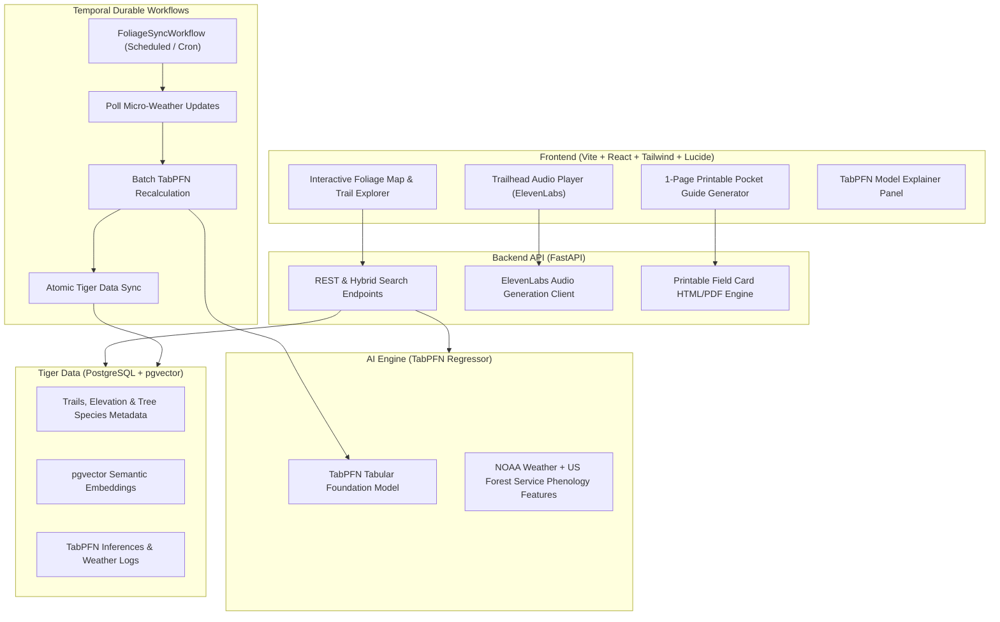

# AGENT.md — Wander 🥾
## Mission: Win the Hacktoberfest 2026 Dev Challenge (Week 1 — Touch Grass)

---

## 🎯 1. Hackathon Context & Rules

* **Challenge:** Hacktoberfest Open-Source AI Challenge: Week 1 — *Touch Grass*
* **Primary Tag:** `#hf26challenge`
* **Deadline:** October 11, 2026 at 11:59 PM PDT (UTC ends Oct 12 at 06:59 AM)
* **Core Prompt:** *"Build something with open-source AI at its core that gets people off the screen and into the world... The best builds here should make the screen the shortest part of the experience."*
* **Judging Weight:**
  1. **Writing Quality** (Weighted highest on DEV)
  2. **Relevance to Prompt & Theme** (*Touch Grass* / Open-Source AI)
  3. **Creativity** (Originality vs. repetitive clones)
  4. **Technical Execution** (Working demo, clean architecture, reproducible code)
  5. **Use of Partner Technology** (Authentic, functional integrations)

---

## 🏆 2. Target Prize Tracks & Prize Pool ($600 Potential)

| Prize Category | Sponsor | Prize | Integration Purpose in Wander |
| :--- | :--- | :--- | :--- |
| **Featured** | **TabPFN (Prior Labs)** | **$200** | Uses TabPFN tabular foundation model to predict chlorophyll breakdown %, peak color window (72h), and days-to-peak from NOAA weather & elevation logs. |
| **Featured** | **Render / DigitalOcean** | **$200** | Deployment runtime for FastAPI backend and Vite/React web client. |
| **Partner** | **Tiger Data** | **$100** | PostgreSQL + `pgvector` store for trail geospatial data, forest tree species distributions, and hybrid natural language semantic search. |
| **Partner** | **Temporal** | **$100** | Durable background workflow that periodically polls weather shifts and orchestrates batch TabPFN model recalculations with automated retries. |
| **Partner** | **ElevenLabs** | **$100** | Generates 45-second audio pre-trail briefings so hikers can listen at the trailhead and put their phones in their pockets. |

---

## 💡 3. The Winning Differentiator: Why Wander Beats the Competition

In Week 1 submissions, the majority of competitors built:
- *3+ Bird sound classifiers* (copied directly from the prompt example).
- *3+ Generic garden frost calculators*.
- *5+ Generic LLM text RPGs / Side-quest generators*.

### Why Wander Stands Out:
1. **Seasonal Timing is Flawless:** October is peak autumn. Foliage forecasting is something millions of real outdoor enthusiasts actively look for.
2. **Authentic Tabular AI (TabPFN):** Phenology (plant cycles) is strictly driven by tabular environmental physics (chill hours, solar radiation, elevation, drought index). TabPFN solves this without overfitting on small datasets.
3. **True Zero-Screen Philosophy:** 
   - **30 seconds on screen:** Plan before you leave.
   - **On the trail:** 1-page printable pocket field card + 45s ElevenLabs audio briefing. The phone stays zipped in the backpack.
4. **Legitimate "Why Open Matters" Story:**
   - Open citizen science replaces coarse, paywalled tourism maps.
   - GPS coordinates and hiking history stay 100% private and on-device / self-hosted without commercial tracking.
   - TabPFN zero-shot tabular inference runs efficiently at zero API cost.

---

## 🏗️ 4. System Architecture



---

## 🌲 5. Directory Structure & Key Files

```
wander/
├── AGENT.md                       # This master execution & hackathon context file
├── README.md                      # Public documentation with setup & architecture diagram
├── docker-compose.yml             # Local PostgreSQL + pgvector + Temporal environment
│
├── backend/
│   ├── app/
│   │   ├── main.py                # FastAPI entry point
│   │   ├── config.py              # Environment settings (Tiger Data, ElevenLabs, TabPFN)
│   │   ├── api/
│   │   │   ├── trails.py          # GET trails, filters, peak timeline
│   │   │   ├── search.py          # POST hybrid natural language search (Tiger Data pgvector)
│   │   │   ├── predict.py         # POST on-demand TabPFN phenology prediction
│   │   │   └── audio.py           # GET ElevenLabs audio briefing stream
│   │   ├── services/
│   │   │   ├── phenology_model.py # TabPFN inference engine & feature preprocessor
│   │   │   ├── tiger_db.py        # PostgreSQL + pgvector connection & seed data
│   │   │   └── elevenlabs_tts.py  # Voice briefing generator
│   │   └── workflows/
│   │       ├── foliage_sync.py    # Temporal durable workflow definition
│   │       ├── activities.py      # Temporal activities (weather fetch, TabPFN batch, DB sync)
│   │       └── worker.py          # Temporal worker process
│   ├── data/
│   │   ├── phenology_dataset.csv  # Historical training dataset for TabPFN
│   │   └── seed_trails.json       # Curated trails across New England, Rockies, Blue Ridge, PNW
│   └── requirements.txt
│
└── frontend/
    ├── package.json
    ├── vite.config.ts
    ├── tailwind.config.js
    └── src/
        ├── App.tsx                # Main dashboard layout
        ├── components/
        │   ├── Header.tsx         # Brand header with autumn aesthetic
        │   ├── FoliageMap.tsx     # Visual map / region foliage progression tracker
        │   ├── TrailList.tsx      # Trail cards with color progress bars & species breakdown
        │   ├── SearchBar.tsx      # Hybrid natural language search bar
        │   ├── ModelExplainer.tsx # TabPFN feature weights & prediction breakdown
        │   ├── AudioBriefing.tsx  # ElevenLabs audio player modal
        │   └── PrintableCard.tsx  # 1-page pocket field guide view for print/PDF
        ├── services/api.ts        # Axios API client
        └── types.ts               # TypeScript interfaces for trails, predictions, & biomes
```

---

## 🚀 6. Step-by-Step Implementation Roadmap

- [ ] **Step 1:** Set up `backend/requirements.txt` with `fastapi`, `uvicorn`, `tabpfn`, `torch`, `asyncpg`, `pgvector`, `temporalio`, `elevenlabs`, `pydantic`.
- [ ] **Step 2:** Build `backend/services/phenology_model.py` with TabPFN tabular regressor predicting `foliage_stage_pct` and `peak_window` based on:
  - `elevation_m`, `chill_hours_cumulative`, `solar_radiation_mj`, `drought_stress_index`, `% Sugar Maple`, `% Quaking Aspen`, `% Red Oak`.
  - Include an offline fallback algorithm for environments without GPU.
- [ ] **Step 3:** Implement `backend/services/tiger_db.py` with PostgreSQL + `pgvector` hybrid search and curated trails dataset.
- [ ] **Step 4:** Define Temporal durable workflows in `backend/workflows/` for automated weather sync and model recalculation.
- [ ] **Step 5:** Integrate ElevenLabs TTS in `backend/services/elevenlabs_tts.py` for 45-second audio trail briefings.
- [ ] **Step 6:** Build modern React + Vite + Tailwind CSS frontend with rich autumn aesthetics, interactive foliage progression bars, natural language search, and 1-page printable pocket guide.
- [ ] **Step 7:** Write comprehensive `README.md` and draft the submission article for DEV `#hf26challenge`.

---

## 📝 7. Submission Checklist for DEV Post

1. **Tag:** Ensure `#hf26challenge` is included.
2. **Title Pattern:** Catchy, humble, clear (e.g. *Wander: How an open tabular model predicts peak autumn foliage so you can leave your phone in your pocket*).
3. **Embed Architecture Diagram:** Rendered via Mermaid on DEV.
4. **Partner Sections:**
   - Section dedicated to **TabPFN** (with tabular regression explanation & confusion/accuracy chart).
   - Section dedicated to **Tiger Data** (Postgres + `pgvector` hybrid query snippet).
   - Section dedicated to **Temporal** (Durable workflow architecture & failure handling).
   - Section dedicated to **ElevenLabs** (Audio briefing embedded).
5. **Session Recording:** Preserved and linked via DevRelay.
