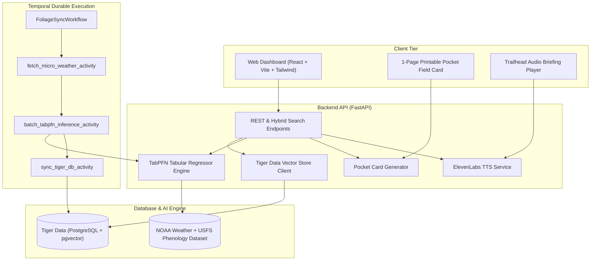

# Wander 🥾
### Open Phenology, Fall Peak Foliage Forecaster & Zero-Screen Trail Companion

[](https://dev.to/t/hf26challenge)
[](https://opensource.org/licenses/MIT)
[](https://fastapi.tiangolo.com)
[](https://priorlabs.ai)
[](https://tigerdata.com)
[](https://temporal.io)
[](https://elevenlabs.io)

> **Built for the DEV Hacktoberfest 2026 Challenge: Week 1 — Touch Grass (`#hf26challenge`)**  
> *"The best builds here should make the screen the shortest part of the experience."*

---

## 💡 The Problem & The Zero-Screen Solution

Every autumn, millions of hikers scramble to catch the elusive **72-hour peak foliage window**. Existing solutions are either:
- Coarse, paywalled tourism statewide maps that lack elevation accuracy.
- Clunky smartphone apps that require constant screen checking on the trail, ruining the immersion of nature.

**Wander** is built on a radical **Zero-Screen Philosophy**:
1. **< 30 seconds on screen:** TabPFN computes the exact 72-hour peak window from micro-weather physics, elevation, and canopy species.
2. **At the trailhead:** Listen to a **45-second ElevenLabs audio briefing** outlining terrain, weather, and key species.
3. **On the trail:** Carry a **1-page printable pocket field card**. Your phone stays zipped away in your backpack.

---

## 🏆 Targeted Partner Tracks ($600 Potential)

| Partner | Role in Wander |
| :--- | :--- |
| **TabPFN (Prior Labs)** | Foundation tabular model forecasting chlorophyll breakdown %, 72h peak color window, and days-to-peak. |
| **Tiger Data** | PostgreSQL + `pgvector` store for trail geospatial data, forest tree species distributions, and hybrid natural language semantic search. |
| **Temporal** | Durable background workflow that periodically polls weather shifts and orchestrates batch TabPFN model recalculations with automated retries. |
| **ElevenLabs** | Generates 45-second audio pre-trail briefings for hands-free trailhead prep. |
| **Render / DigitalOcean** | Cloud deployment runtime for FastAPI backend and Vite/React web client. |

---

## 🏗️ System Architecture



---

## 🚀 Quickstart (Pure Python — No Docker Required)

### 1. Prerequisites
- Python 3.10+
- Node.js 18+ (for frontend)

### 2. Backend Setup
```bash
# Navigate to backend
cd backend

# Create virtual environment
python3 -m venv venv
source venv/bin/activate

# Install dependencies
pip install -r requirements.txt

# (Optional) Copy .env.example to .env and configure API keys
cp .env.example .env

# Run FastAPI development server
uvicorn app.main:app --reload --port 8000
```

Visit the interactive API docs at **[http://localhost:8000/docs](http://localhost:8000/docs)**.

### 3. Frontend Setup (React + Vite + Tailwind + Motion)
```bash
# Navigate to frontend
cd frontend

# Install dependencies
npm install

# Start development server
npm run dev
```

Visit the interactive web app at **[http://localhost:5173](http://localhost:5173)**.

---

## 🧪 Testing Backend Endpoints

### 1. List Trails with Live TabPFN Peak Predictions
```bash
curl http://localhost:8000/api/trails
```

### 2. Hybrid Natural Language Vector Search (Tiger Data)
```bash
curl -X POST http://localhost:8000/api/search \
  -H "Content-Type: application/json" \
  -d '{"query": "golden aspen trees near mountain lakes", "limit": 3}'
```

### 3. Generate 45s ElevenLabs Audio Briefing
```bash
curl -X POST http://localhost:8000/api/audio/briefing \
  -H "Content-Type: application/json" \
  -d '{"trail_id": "trail-franconia-ridge-nh", "hiker_name": "Alex"}'
```

### 4. Export 1-Page Printable Pocket Field Guide
```bash
curl -X POST http://localhost:8000/api/card/export \
  -H "Content-Type: application/json" \
  -d '{"trail_id": "trail-maroon-bells-co"}'
```

---

---

## ☁️ Deployment on Render

Wander is fully configured for zero-friction hosting on **[Render](https://render.com)**.

### Option A: One-Click Render Blueprint (Recommended — 100% Free Tier)
Deploy both the FastAPI backend and React static frontend automatically via Infrastructure as Code:
1. Connect your repository to Render.
2. Select **New +** > **Blueprint**.
3. Select this repository. Render automatically reads [`render.yaml`](./render.yaml), sets up the **FastAPI Web Service** and **React Static Site**, and wires their environment variables together.

### Option B: Unified Container (Single Web Service)
Build and run the full stack as a single multi-stage Docker container via [`Dockerfile`](./Dockerfile):
- Select **New +** > **Web Service** on Render with runtime **Docker**.
- Health Check Path: `/health`.

For full setup details, environment variables, and zero-downtime healthcheck instructions, see **[Render Deployment Guide](docs/DEPLOYMENT.md)**.

---

## 🌲 Repository Structure

```
wander/
├── README.md                      # Public documentation & quickstart
├── render.yaml                    # Render Blueprint Infrastructure as Code
├── Dockerfile                     # Multi-stage production container
├── .dockerignore                  # Docker build exclusions
├── .python-version                # Python 3.12 runtime specification
├── AGENT.md                       # Master context & hackathon strategy
├── WANDER_SPEC.md                 # Technical specification
├── .gitignore                     # Git ignore rules
│
├── docs/                          # In-depth architectural & API documentation
│   ├── ARCHITECTURE.md            # Detailed system design & flowcharts
│   ├── API_REFERENCE.md           # Comprehensive REST API specifications
│   └── DEPLOYMENT.md              # Complete Render hosting & runbook
│
├── backend/                       # Python FastAPI Backend
│   ├── app/
│   │   ├── main.py                # FastAPI entry point, CORS & static SPA serving
│   │   ├── config.py              # Pydantic Settings configuration
│   │   ├── api/                   # Modular REST route handlers
│   │   │   ├── trails.py          # GET /api/trails
│   │   │   ├── search.py          # POST /api/search (Hybrid pgvector)
│   │   │   ├── predict.py         # POST /api/predict/foliage
│   │   │   ├── audio.py           # POST /api/audio/briefing (ElevenLabs)
│   │   │   ├── card.py            # POST /api/card/export (Printable card)
│   │   │   └── workflows.py       # POST /api/workflows/trigger-sync
│   │   ├── services/              # Core business & AI logic
│   │   │   ├── phenology_model.py # TabPFN tabular regressor engine
│   │   │   ├── tiger_db.py        # Tiger Data PostgreSQL + pgvector client
│   │   │   ├── elevenlabs_tts.py  # ElevenLabs 45s audio generator
│   │   │   └── pocket_card.py     # 1-page printable pocket guide engine
│   │   ├── schemas/               # Pydantic data schemas
│   │   └── workflows/             # Temporal durable workflows & activities
│   ├── data/
│   │   ├── seed_trails.json       # Curated trails across US autumn regions
│   │   └── phenology_dataset.csv  # USFS & NOAA historical training data
│   ├── requirements.txt
│   ├── .python-version
│   └── .env.example
│
└── frontend/                      # React + Vite + Tailwind UI
    ├── src/                       # Components, views, animations & API client
    ├── package.json
    ├── .env.example
    └── vite.config.ts
```

---

## 📜 License
MIT © 2026 Wander Team. Built with open-source passion for Hacktoberfest 2026.
