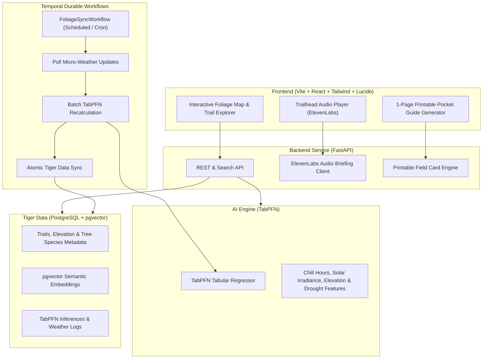

# Wander 🥾
### Open Phenology, Fall Peak Foliage Forecaster & Zero-Screen Trail Companion

> **Hackathon Track:** Hacktoberfest 2026 Dev Challenge: Week 1 — *Touch Grass*  
> **Repository:** `wander`  
> **Core Concept:** An open-source AI companion that predicts the exact 72-hour peak foliage window for hiking trails using TabPFN, indexes forest biomes in Tiger Data with pgvector hybrid search, syncs weather shifts durably via Temporal, and generates trailhead ElevenLabs audio briefings & printable 1-page pocket guides so hikers can put their screens away on the trail.

---

## 🏆 Target Prize Categories

| Track | Partner | Potential Prize | Role in Wander |
| :--- | :--- | :--- | :--- |
| **Featured** | **TabPFN (Prior Labs)** | **$200** | Tabular foundation model forecasting chlorophyll decay and peak color dates from NOAA weather & elevation features. |
| **Featured** | **Render / DigitalOcean** | **$200** | Hosted web explorer & FastAPI backend runtime. |
| **Partner** | **Tiger Data** | **$100** | PostgreSQL + `pgvector` hybrid search for trail coordinates, canopy compositions, and natural language route discovery. |
| **Partner** | **Temporal** | **$100** | Durable workflow orchestrating periodic weather updates and model re-inference pipelines. |
| **Partner** | **ElevenLabs** | **$100** | 45-second audio pre-trail briefings for zero-screen outdoor exploration. |

---

## 🏗️ System Architecture

---

## 🌲 Core Components

### 1. TabPFN Phenology Model (`backend/services/phenology_model.py`)
TabPFN ingests tabular environmental metrics to predict color transition:
- **Features ($X$):**
  - `elevation_m`: Elevation in meters (color turns ~3-4 days earlier per 1,000 ft).
  - `chill_hours_cumulative`: Hours between $0^\circ\text{C}$ and $7^\circ\text{C}$ since Sept 1.
  - `solar_radiation_mj`: Cumulative solar radiation / day length shortening.
  - `drought_stress_index`: Rainfall deficit index over the last 30 days.
  - `sugar_maple_pct`, `quaking_aspen_pct`, `red_oak_pct`: Dominant tree species breakdown.
- **Outputs ($y$):**
  - `foliage_stage_pct`: Progression ($0\%$ = Green, $50\%$ = Turning, $100\%$ = Peak Vibrant, $>100\%$ = Past Peak).
  - `peak_start_date` & `peak_end_date`: 72-hour window of maximum vibrancy.

### 2. Tiger Data Knowledge Store (`backend/db/tiger_data.py`)
- PostgreSQL database with `pgvector` extension enabled.
- Stores trail coordinates, distance, elevation gain, forest species distribution, and high-dimensional semantic embeddings.
- Supports hybrid search: filter by strict criteria (e.g. *difficulty=moderate, peak_within_days=5*) and semantic descriptions (e.g. *golden mountain passes with lake reflections*).

### 3. Temporal Durable Workflow (`backend/workflows/foliage_sync.py`)
- Resilient background pipeline that checks weather changes, handles API rate limits, and triggers batch TabPFN predictions without state loss.

### 4. Zero-Screen Trail Companion
- **ElevenLabs Trailhead Audio:** 45-second audio briefing summarizing trail conditions, tree species, and optimal vista points.
- **Printable Pocket Guide:** Clean, printer-friendly 1-page cheat sheet with trail milestones, elevation checkpoints, and leaf silhouettes.

### 5. Modern Web Interface (`frontend/`)
- Warm autumn color palette (amber, cinnabar, golden yellow, forest emerald).
- Interactive map & trail cards showing live foliage progress meters.
- Filter by peak timeline, region, difficulty, and species.

---

## 📝 DEV Hackathon Write-Up Angle: "Why Open Innovation Matters"
- **Open Citizen Science:** Proprietary tourism foliage maps are static and coarse. Open models let hikers compute hyper-local predictions directly from open meteorological and forestry datasets.
- **Privacy First:** GPS coordinates and personal hiking logs are evaluated locally or in a self-hosted database rather than monetized by commercial ad trackers.
- **Low-Power & Zero-Cost:** TabPFN runs lightning-fast zero-shot tabular inference without costly multi-billion parameter cloud LLM calls.
