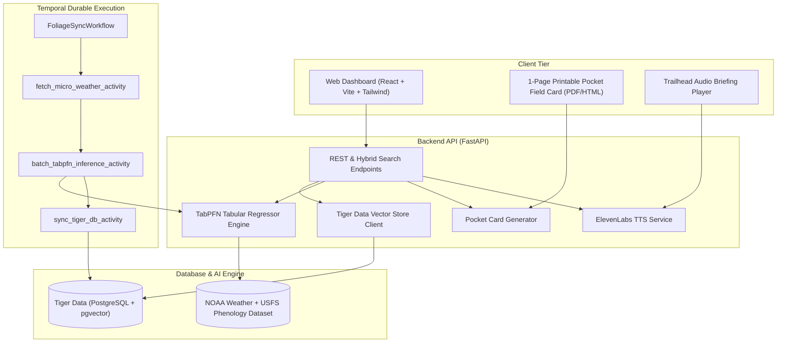

# Wander System Architecture 🌲

Wander is an open-source phenological forecasting engine and zero-screen trail companion built for **Hacktoberfest 2026: Week 1 — Touch Grass**.

---

## 🏗️ High-Level System Flow

---

## 🏆 Partner Integrations

### 1. TabPFN (Prior Labs) — Tabular Foundation Model
- **Role:** Predicts canopy chlorophyll decay %, 72-hour peak foliage window, and days-to-peak.
- **Inputs:** Elevation, latitude, cumulative chill hours (hours $0^\circ\text{C}-7^\circ\text{C}$ since Sept 1), solar irradiance shortening, drought stress index, and species distribution (Sugar Maple, Quaking Aspen, Red Oak, American Beech, Alpine Larch).
- **Zero-Shot Generalization:** TabPFN fits historical USFS phenology curves instantly without extensive fine-tuning.

### 2. Tiger Data — PostgreSQL + `pgvector`
- **Role:** High-performance relational metadata + high-dimensional vector embeddings for hybrid natural language trail search.
- **Hybrid Search Algorithm:** Blends cosine similarity over trail biome embeddings ($60\%$) with keyword and structural metadata filters ($40\%$).

### 3. Temporal — Durable Workflow Orchestration
- **Role:** Periodic micro-weather polling and automated batch TabPFN model recalculations with automated exponential backoff retries.

### 4. ElevenLabs — Voice Briefing Synthesis
- **Role:** Generates 45-second high-fidelity trailhead audio briefings to minimize screen time outdoors.
